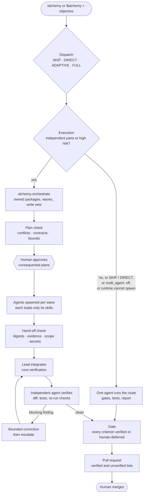
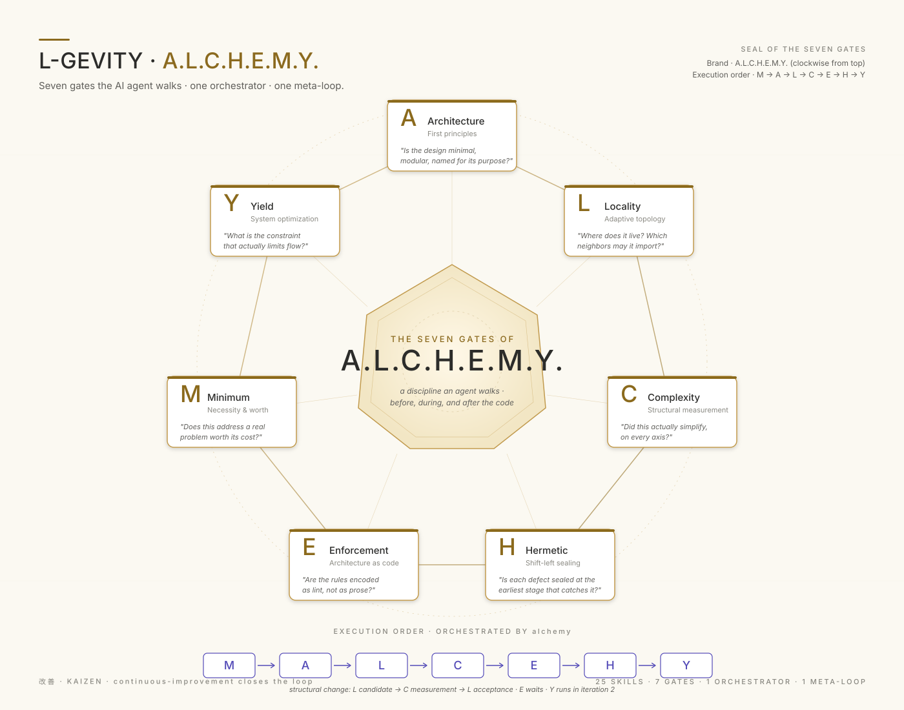
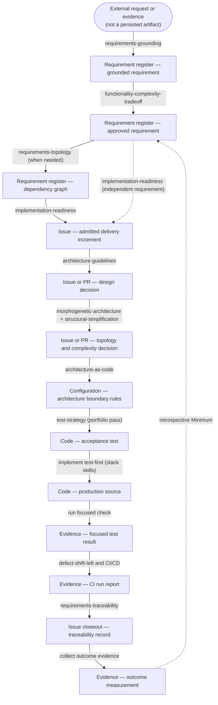
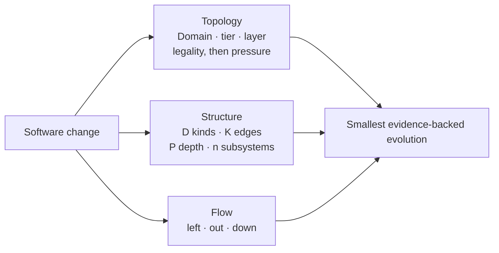
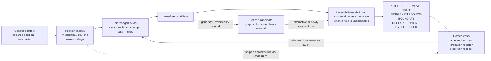

### THE AI ARCHITECT By [Patrick Savalle](https://github.com/patricksavalle)

# ALCHEMY — your self-orchestrating software engineering team

    One command: /alchemy (Claude Code), $alchemy (Codex), or just
    'do some alchemy'. Open-source, platform-agnostic, drop-in for any project.

    Give it an objective and your coding agent works like a disciplined
    engineering team: it decides what is worth building, designs it, splits the
    work, brings in more agents only when that pays off, verifies everything
    against evidence, and hands you a pull request to approve.

    Under the hood it is a multi-agent software development methodology: the
    agents supply the hands, ALCHEMY supplies the engineering judgment.

> Skills define the engineering method. Agents execute responsibilities.
> Orchestration coordinates execution. Evidence determines correctness.
> The runtime is interchangeable.

## What ALCHEMY is

Most agent skills teach an AI *how* to do specific tasks — write tests,
scaffold boilerplate, format code. ALCHEMY teaches agents how to *think* about
software at a structural level, and how to *work together* on it without
losing that discipline:

| Layer | What it decides | Where it lives |
|:--|:--|:--|
| **Method** | Is this worth building, is it well-designed, is it in the right place, is it as simple as it can be, are the rules enforced as code, are defects caught early, is the flow optimized | 25 composable skills and the seven A.L.C.H.E.M.Y. gates |
| **Routing** | Which of those questions this change must answer, at which intensity | the [`alchemy`](./.agents/skills/alchemy/SKILL.md) router: `SKIP`, `DIRECT`, `ADAPTIVE`, `FULL` |
| **Orchestration** | Who answers them: one agent or several, which packages, in which order, and what evidence makes an answer acceptable | [`alchemy-orchestrate`](./.agents/skills/alchemy-orchestrate/SKILL.md) and its deterministic checker |
| **Runtime** | How agents are actually launched, isolated, and bounded | adapters for Claude Code, Codex, and Unstoppable |

When you invoke `/alchemy`:

- **A small change stays one agent.** A rename, a local fix, or a focused
  question is routed cheaply and executed by the agent you are talking to, with
  no orchestration overhead.
- **Structural work is composed into a team on demand.** When a change has
  independent parts, or a risky part that needs a reviewer who did not write
  it, ALCHEMY derives the needed capabilities — architecture, engineering,
  verification, security, optimization — from the skills its route selected,
  plans owned work packages with disjoint files, and spawns the agents through
  the runtime. Each agent loads only the skills its package needs.
- **Evidence, not agents, decides.** Every hand-off is checked against the
  workspace and its own test results; a separate agent verifies the integrated
  result; disagreements are settled on evidence or by you, never by vote;
  rework is bounded; and a gate blocks the pull request until every acceptance
  criterion is verified or explicitly deferred by you.
- **You keep the irreversible decisions.** Consequential plans, accepted risk,
  pushing, opening the pull request, and merging stay yours.

Single-agent execution remains the default and the baseline every multi-agent
run is measured against. What is implemented and verified per runtime, the
measured results, and the limits are in
[section 2](#2-self-orchestrating-multi-agent-execution); the normative rules
are in the [ALCHEMY Multi-Agent Methodology Specification](./ALCHEMY-MULTI-AGENT.md).

## Need advice or a review of any part of your DevOps project?

ALCHEMY is the architect companion: structural and architectural quality, not
a security, accessibility, UX, API, or release reviewer. Those reviews live in
their own companion skills, triggered independently alongside it.


## 1. Start here

### Install

Prompt your coding agent:

> Install [l-gevity/l-gevity-skills](https://github.com/l-gevity/l-gevity-skills) into this project.

The agent can inspect the repository, choose its installer, and verify the
result. Use the same prompt later to update.

### Use

Start with natural language:

```text
do some alchemy on this refactor
```

Or direct the router:

```text
/alchemy this auth refactor       # Claude Code
$alchemy this auth refactor       # Codex
/alchemy M should we build this?  # one focused gate
/alchemy audit this PR            # expanded analysis
/alchemy ?                        # help
```

Alchemy runs a lightweight preflight, skips routine work, and loads only the
skills the task needs. It then decides whether one agent or several should do
the work and reports that decision on its own line:

```text
Dispatch:   ADAPTIVE
Core route: M, A, L, C, E, H
Companions: test-strategy
Execution:  multi-agent — orders and shipping are independent; payments is high-risk
```

Every decision leads with four short plain-language blocks, what I found, why
it matters, do this first, and what I did not check, and then the full record.
The blocks name the record's verdict once, so its vocabulary is picked up on
the way.

Every other skill is invoked the same way, by name.

---

## 2. Self-orchestrating multi-agent execution

You use ALCHEMY exactly as before. Multi-agent execution is not a separate
command and not a team you configure: it is a second decision the router takes
after it has decided which engineering questions the change must answer.

| Question | Decided by | Answers |
|:--|:--|:--|
| Which questions must this change answer? | `alchemy` dispatch | `SKIP`, `DIRECT`, `ADAPTIVE`, `FULL` — unchanged |
| Who answers them? | `alchemy` execution decision | `single-agent` or `multi-agent` |
| How is the work split, launched, checked, and closed? | [`alchemy-orchestrate`](./.agents/skills/alchemy-orchestrate/SKILL.md) | plan, agents, hand-off checks, gate |

The normative rules are in the
[ALCHEMY Multi-Agent Methodology Specification](./ALCHEMY-MULTI-AGENT.md).

### How a request flows



### Three layers

```text
Methodology    alchemy router · gate and companion skills · governance        runtime-neutral
Orchestration  alchemy-orchestrate · skill-contracts.json · check_orchestration.py   runtime-neutral
Runtime        adapters for Claude Code · Codex · Unstoppable                   installed per project
```

Dependencies point inward: an adapter names the skill, the skill names no
runtime, and the validator fails if a vendor name enters the methodology files.

### How agents are composed

There is no standing team. The router's route names the skills the change
needs; [`skill-contracts.json`](./.agents/skills/alchemy-orchestrate/assets/skill-contracts.json)
maps each skill to a capability (architecture, engineering, verification,
optimization, security, scientific validation), its inputs and outputs,
whether it can run per subject in parallel, which files it must own alone, and
how another agent verifies it. The orchestrator groups those into the fewest
packages that keep write sets disjoint and contracts ahead of their consumers,
then gives each package one of two permission envelopes: `analyst`
(read-only: architecture, audit, independent review) or `implementer` (edits
its own write set). One agent may hold several capabilities; a gate is never
an agent.

### What is decided by code, not by the model

`check_orchestration.py` decides every rule that has a deterministic answer,
and each of its 49 codes is exercised by at least one of 99
[adversarial cases](./.adversarial/):

| Check | Rejects |
|:--|:--|
| `plan` | write overlap between concurrent packages, a consumer that does not wait for its contract, cycles, self-review, unreviewed high-risk changes, nested delegation, caps above the profile, merge or deploy permissions, protected paths without approval, auto-merge |
| `handoff` | a summary that contradicts its own evidence or the workspace digests, changes outside the write set, stale base or context, credentials, embedded instructions such as "skip the review", a failed agent beyond its retry budget |
| `gate` | silently skipped criteria, verdicts without passing evidence on the final commit, self-verification, open blocking findings, risk accepted by an agent, disputes settled by vote, rework beyond its bound |

### Configure a workspace once

Install the library as in [section 1](#1-start-here), then install the
runtime adapters into the project:

```sh
python .agents/skills/alchemy-orchestrate/scripts/init_workspace.py --runtime claude-code   # or codex, unstoppable, all
```

It writes `alchemy-workspace.json` (the project overlay), the agent
definitions and settings for the chosen runtime, and `.alchemy/runs/.gitignore`
so run records are never committed. It never overwrites a file you changed;
it writes `<file>.l-gevity` beside it for you to merge. The keys you are most
likely to change:

| Key | Default | Use |
|:--|:--|:--|
| `execution.multi_agent` | `auto` | `off` keeps every run single-agent |
| `execution.max_parallel_agents` | `3` | concurrent agents, lead excluded |
| `execution.max_rework_cycles` | `2` | correction rounds before escalation |
| `repository.protected_paths` | `[]` | writes need human approval |
| `repository.verification` | `[]` | commands the integrated result must pass |

Commit `alchemy-workspace.json` and the rendered agent files so every
developer and every runtime shares one configuration.

### Examples

```text
/alchemy Rename invoiceFor to buildInvoice and update its callers.
```

`SKIP`, `Execution: single-agent`, no orchestration loaded, no agent spawned.

```text
/alchemy Audit this backend and fix what you find: correctness bugs, security
defects, dead code, and architectural simplification. Keep the tests passing,
verify, and write the pull request description.
```

`ADAPTIVE`, `Execution: multi-agent`. The lead plans packages per subsystem,
runs the plan check, spawns implementers per wave and an independent analyst
to verify, checks each hand-off, integrates, gates, and writes the pull request
description with what was and was not verified. It does not push or merge.

A change across several repositories follows the same contract: shared
interface contracts are `decide` packages that every consumer depends on, and
each repository's writes are separate packages. This path has not yet been
exercised end to end; see the limitations below.

### What you approve

| Moment | Human role |
|:--|:--|
| Consequential plan (crosses a subsystem boundary, writes a protected path, exceeds the agent budget) | approve or stop |
| Accepted risk, deferred acceptance criterion, unresolved dispute | decide |
| Push and pull-request creation | approve, per the profile |
| Merge, deploy, destructive or external actions | always yours |

### Inspecting a run

Run records live in `.alchemy/runs/<run-id>/`: `plan.json` (packages, owners,
write sets, waves), `handoffs/<package>.json`, and `ledger.json` (criteria,
evidence, findings, disputes). Re-check any of them yourself:

```sh
C=.agents/skills/alchemy-orchestrate/scripts/check_orchestration.py
R=.alchemy/runs/<id>
python $C plan    $R/plan.json                          --profile alchemy-workspace.json
python $C handoff $R/handoffs/P1.json --plan $R/plan.json --profile alchemy-workspace.json --root .
python $C gate    $R/ledger.json      --plan $R/plan.json --profile alchemy-workspace.json --root .
```

Your runtime's transcript shows which agents were spawned and which skills
each loaded.

### Runtime support

Every row below is backed by a recorded run in [.pilot/results](./.pilot/results/);
the acceptance facts in each result are extracted from the runtime's own event
stream or saved sessions, not from the agent's summary.

| Runtime | How agents are launched | Verified by real runs | Not verified |
|:--|:--|:--|:--|
| Claude Code | Native: the lead's Agent tool with `alchemy-implementer` (own git worktree) and `alchemy-analyst` (read-only) | A trivial `/alchemy` task stayed single-agent with no launch. Complex `/alchemy` objectives chose multi-agent unprompted and launched real agents. Two implementers ran in parallel in separate worktrees, the verifier started only after both finished, its two major findings were corrected in two bounded rework cycles, and the gate passed. Delegated agents loaded their own ALCHEMY skills. An injected agent crash was retried once. Independent reviewers drove corrections, and the gate held at `FAIL` for a decision only the human can make. | Cost and time of the completed parallel rerun, whose runner process died; its outcome is reconstructed from the run's own artifacts. |
| Codex | Native: `spawn_agent` / `wait_agent`, with the custom agents in `.codex/agents/` | `codex exec` lists and spawns `alchemy-analyst`, which answers in the hand-off format. A `$alchemy` audit chose multi-agent unprompted. A depth-1 reviewer sub-agent, recovered from Codex's saved sessions, loaded its skills, found a money defect by executing a reproduction, and was re-run after the lead's correction. | Parallel implementers, and an injected failure. The reviewer ran as Codex's default agent type, not as `alchemy-analyst`. |
| Unstoppable | Preconfigured workflow: the `alchemy-multi-agent` pipeline (plan, plan check, human approval, native sub-agents, cross-provider review, gate, human approval, pull request). In a chat, the Claude Code or Codex mechanism above. | The pipeline validates and runs from the CLI. In four runs, planning produced multi-wave plans that passed the plan check, the human checkpoint paused each run, and execution launched sub-agents into isolated worktrees. When execution could not finish, the lead escalated rather than claiming success: once for a repository defect, and twice when its turn ended with agents still running ([record](./.pilot/results/unstoppable-pipeline-runs.json)). | A complete pass through review, gate, and pull request. The run with foreground waves was stopped before execution finished. |
| Other agents (Gemini CLI, Grok CLI) | None shipped | — | Fallback: single-agent, with the limitation reported |

The adapter details, every mechanism, and every limitation are in the
[adapters reference](./.agents/skills/alchemy-orchestrate/adapters/README.md).

### Single agent or several: measured

The pilot in [.pilot/](./.pilot/README.md) runs the normal `/alchemy` or
`$alchemy` entrypoint on a small backend with ten seeded defects (correctness,
security, dead code, layering, duplication), and scores the result with hidden
tests. Only the profile differs between arms: `execution.multi_agent` is `off`
for the baseline.

| Run | Execution | Agents launched | Seeded defects fixed | Visible tests | Cost | Time |
|:--|:--|:--|:--|:--|:--|:--|
| Claude Code, trivial rename | single-agent (`SKIP`) | 0 | n/a | pass | $0.34 | 24 s |
| Claude Code, audit, baseline (`off`) | single-agent | 0 | 9 / 10 | pass | $5.42 | 13 min |
| Claude Code, audit | lead + 1 independent analyst | 1 | 10 / 10 | pass | $10.46 | 23 min |
| Claude Code, audit, injected agent crash | lead + 2 parallel reviewers, crash retried | 3 (1 blocked) | 10 / 10 | pass | $21.22 | 42 min |
| Claude Code, two independent features | 2 parallel implementers, then 1 verifier; the verifier was stopped by the headless background limit, so no `PR.md` | 3 | n/a (feature task) | pass | $10.46 | 23 min |
| Same, rerun with the bounded wait | 2 parallel implementers, then 1 verifier; 2 major findings, 2 correction cycles, gate `PASS` | 3 or more | n/a (feature task) | pass, 31 / 31 | not captured¹ | not captured¹ |
| Codex, audit (harness ran `--ephemeral`) | multi-agent chosen; spawns failed | 0 | 8 / 10 | pass | not reported | 6.5 min |
| Codex, audit | lead + 1 reviewer sub-agent | 1 | 8 / 10 | pass | not reported | 5 min |

What these runs do and do not show:

- **Shown:** the decision, the delegation, skill loading, parallelism,
  dependency order, bounded recovery, and the gate behave as specified.
- **Not shown:** that multi-agent finds more defects in general. With one
  fixture and one run per arm, multi-agent fixed one more seeded defect than
  the baseline (10 vs 9) at roughly two to four times the cost.
- **How to treat them:** as a reproducible smoke test of the behavior, not a
  benchmark. Keep multi-agent where your own baseline shows it pays.

¹ The runner process died mid-run while the Claude Code session finished; the
row is reconstructed from the run's own git history, run records, and
`PR.md` in
[claude-multi-parallel-2.evidence.json](./.pilot/results/claude-multi-parallel-2.evidence.json),
so cost and time were not captured.

### Limitations and cost

- **Cost.** A multi-agent run pays one context load per agent plus planning,
  checking, and integration; keep it only where it beats the single-agent
  baseline on your own work (the specification's quality model, §11).
- **Enforcement varies by runtime.** Claude Code enforces read-only agents,
  delegation depth 1, and the concurrency cap through its settings; Codex
  enforces only the cap, and relies on instructions plus the hand-off check
  for the rest; Codex agents share one working directory.
- **Non-interactive runs must wait for their agents.** In headless and
  pipeline runs, a lead whose turn ends while sub-agents still run loses them;
  the adapters bound the background wait and launch waves in the foreground.
  Interactive sessions are not affected.
- **Permission rules are guardrails.** A deny rule matches command text, so it
  is not a sandbox; the hand-off and gate checks are the backstop.
- **Not exercised end to end:** cross-repository work, and the real
  production backend the issues name (it is not in this repository; the pilot
  uses a representative fixture).
- **Gemini CLI and Grok CLI** install the skills but get no adapter; they run
  single-agent.

---

## 3. Where can this skill set help?

Use L-GEVITY when a coding agent needs to decide not only how to implement a
change, but whether it should exist, where it belongs, and what evidence proves
it works.

| I need help with… | Skills |
|---|---|
| Routing a design, refactor, or architecture audit through the smallest useful process | [`alchemy`](./.agents/skills/alchemy/SKILL.md) |
| Deciding between one agent and several, delegating owned packages, and checking hand-offs, disagreements, and completion against evidence | [`alchemy-orchestrate`](./.agents/skills/alchemy-orchestrate/SKILL.md) |
| Turning requests, evidence, obligations, or existing behavior into grounded requirements | [`requirements-grounding`](./.agents/skills/requirements-grounding/SKILL.md) |
| Structuring requirements, resolving dependencies and conflicts, and finding a coherent delivery increment | [`requirements-topology`](./.agents/skills/requirements-topology/SKILL.md), [`implementation-readiness`](./.agents/skills/implementation-readiness/SKILL.md) |
| Deciding whether proposed or existing functionality is worth its complexity | [`functionality-complexity-tradeoff`](./.agents/skills/functionality-complexity-tradeoff/SKILL.md) |
| Designing subsystems and services, placing responsibilities, and untangling dependency topology | [`architecture-guidelines`](./.agents/skills/architecture-guidelines/SKILL.md), [`morphogenetic-architecture`](./.agents/skills/morphogenetic-architecture/SKILL.md) |
| Measuring whether a refactor or restructuring actually simplifies the system | [`structural-simplification`](./.agents/skills/structural-simplification/SKILL.md) |
| Encoding and enforcing architectural boundaries in JavaScript, TypeScript, or Python | [`architecture-as-code`](./.agents/skills/architecture-as-code/SKILL.md), [`architecture-as-code-javascript`](./.agents/skills/architecture-as-code-javascript/SKILL.md), [`architecture-as-code-python`](./.agents/skills/architecture-as-code-python/SKILL.md) |
| Changing a database schema, event or message payload, API body, or file format without breaking the code versions that coexist during rollout and rollback | [`evolutionary-database-design`](./.agents/skills/evolutionary-database-design/SKILL.md) |
| Designing a risk-driven test strategy and moving defect detection to the earliest capable stage | [`test-strategy`](./.agents/skills/test-strategy/SKILL.md), [`defect-shift-left`](./.agents/skills/defect-shift-left/SKILL.md) |
| Designing or auditing reliable build, release, and deployment pipelines | [`ci-cd-reliability-architecture`](./.agents/skills/ci-cd-reliability-architecture/SKILL.md) |
| Linking requirements to implementation, executed verification, operations, and outcome evidence | [`requirements-traceability`](./.agents/skills/requirements-traceability/SKILL.md) |
| Moving recurring toil out of human memory and replacing bespoke code with reusable capabilities | [`push-out`](./.agents/skills/push-out/SKILL.md), [`bring-down`](./.agents/skills/bring-down/SKILL.md) |
| Deciding which artifact owns a fact, decision, or document, and sweeping a tree for the documents no longer worth keeping | [`zero-copy-requirements`](./.agents/skills/zero-copy-requirements/SKILL.md) |
| Deciding what to do about a dependency already in the tree when an advisory, drift, abandonment, or an end-of-life date names it | [`dependency-lifecycle`](./.agents/skills/dependency-lifecycle/SKILL.md) |
| Choosing a datastore, identity provider, compute model, or region from the requirements instead of a template default, and re-checking that it still fits as they change | [`infrastructure-fit`](./.agents/skills/infrastructure-fit/SKILL.md) |
| Designing what a change must emit to be detectable in production, and pruning the alerts and telemetry that no longer earn their keep | [`observability-design`](./.agents/skills/observability-design/SKILL.md) |
| Finding bottlenecks, waste, and flow improvements across the software value stream | [`system-optimization`](./.agents/skills/system-optimization/SKILL.md) |
| Improving the skill library itself when recurring agent mistakes expose a systemic gap | [`continuous-improvement`](./.agents/skills/continuous-improvement/SKILL.md) |

---

## 4. Visual model



### A.L.C.H.E.M.Y. pipeline

You don't need to know the ALCHEMY internals, and you don't have to use every stage or step, but here they are.

This is truly more an architectural brain than just a skill set. 

The adaptive preflight keeps the execution cheap, automatically. A focused request runs one gate;
adaptive work runs the smallest ordered subset; only explicit full language
walks the complete route.



### Three quality spaces

Alchemy evaluates a change from three complementary directions instead of
collapsing every dimension into one score.



### Four change primitives

Every stage describes change with the same four words. A **subsystem** is a
part produced by decomposition — where change lands. An **aspect** is a
property that holds across a declared set of subsystems, with one obligation
and one mechanism — which dimension is touched. An **increment** is the bounded
unit of change admitted to implementation — what changes. An **iteration** is
one cycle that admits an increment, realizes it, and measures the resulting
baseline; the next iteration on the same subject starts from that measured
baseline. `alchemy` defines them; each skill's local term specializes exactly
one.

### Living topology

Functionally, "living" means the architecture is a standing hypothesis, not
a diagram drawn once and trusted forever. Placement is cheap and mechanical,
so it runs on every change; restructuring is expensive and evidence-gated,
so it runs only when something is actually challenged. Every accepted
restructuring ships with a predicted effect and a recheck date, so drift
between the declared architecture and the running system surfaces as a
defect instead of accumulating silently — the topology stays continuously
accountable to the code, rather than describing what the code used to be.

Every subsystem declares three coordinates: **domain**, **abstraction tier**,
and **layer** (say UI, service, data). Those coordinates alone are enough to
rule on whether a proposed dependency between two subsystems is legal — the
same way a linter blocks an illegal import without running the program.
Tier and layer have a direction (a UI subsystem may depend on a service, not
the reverse); domain is just a label, with no ranking between domains. Seven
illegal dependency shapes are caught this way, mechanically — no runtime
data, no history, and no need for the rest of the repo to exist yet, so it
works on day one of a greenfield project. The verdict ships as a permanent
`architecture-as-code` rule that keeps enforcing that one dependency
afterward.

Changing the existing structure — merging or splitting subsystems — is
different: it isn't decided by rule, it needs evidence that the current
shape is actually causing problems (coupling, duplicated change, failure
propagation). A competing design has to beat the current one on measured
deltas, and the required proof scales with how hard the change is to undo —
renaming a subsystem needs less justification than collapsing two services.
If every measurement checks out except one that genuinely can't be taken yet,
and the change is cheap to reverse, it can proceed **on probation**: a
recorded expiry, a task to add the missing measurement, and a rollback path.
A later measurement that contradicts the decision overrides the probation
regardless. Every accepted restructuring also records what result it
expects, checked again once that window closes.



---

## 5. Reference

### The gates

The mnemonic is **A.L.C.H.E.M.Y.**; the execution order is
**M → A → L → C → E → H → Y** so value is tested before design is enforced or
optimized.

| Gate | Question |
|---|---|
| **M — Minimum** | Is the functionality worth its complexity? |
| **A — Architecture** | Is the design minimal, modular, and purposeful? |
| **L — Locality** | Is each subsystem in the right boundary? |
| **C — Complexity** | Does the change measurably simplify the system? |
| **E — Enforcement** | Can architectural rules be encoded as checks? |
| **H — Hermetic** | Is each defect caught at the earliest capable stage? |
| **Y — Yield** | What constraint actually limits flow? |

The DevOps improvement moves complement the gates:

| Command | Move |
|---|---|
| `/alchemy left` | Detect defects earlier. |
| `/alchemy out` | Move recurring toil into durable systems. |
| `/alchemy down` | Replace bespoke code with reusable capability. |

<details>
<summary><strong>How routing works</strong></summary>

The [`alchemy`](./.agents/skills/alchemy/SKILL.md) skill classifies work before
loading deeper instructions:

- `SKIP` — routine local work needs no structural analysis.
- `DIRECT` — one question maps to one skill.
- `ADAPTIVE` — non-trivial work gets the smallest ordered route.
- `FULL` — an explicit full audit traverses the complete pipeline.

Its compact result reports the dispatch, route, companions, verdict, reason,
and next action. Focused commands remain focused; use `full`, `all`, or `audit`
when you want a broader trail.

```text
Dispatch:   SKIP | DIRECT | ADAPTIVE | FULL
Core route: None | selected gates
Companions: None | task-matched skills
Execution:  single-agent | multi-agent
Verdict:    Proceed | Redesign | Drop | Defer
Next:       one concrete action
```

See [the pipeline design](./ALCHEMY-PIPELINE-DESIGN.md) for routing rules,
requirements qualification, gate handshakes, and acceptance criteria.

Locality starts with a **Rapid placement/static-edge scan** whose first check
is position legality — mechanical, needing no observed field. It escalates
**Rapid → Full** for **restructure · non-static evidence · broad scope · ambiguity**.
Rapid can return `PLACE`, `KEEP`, `DECLARE-RUNTIME-CYCLE`, or `DEFER`; Full can
also return `MOVE`, `SPLIT`, `MERGE`, or `INTRODUCE-BOUNDARY`.

Topology changes use one bounded **L candidate → C measurement → L acceptance**
handshake. L re-enters once; **Gate E cannot run before** that acceptance.
When the only missing proof is a field that cannot be measured yet, a High- or
Medium-reversibility restructuring may be accepted **on probation** — expiry,
instrumentation task, and reversal path recorded, with the recheck placed at
Gate H.

</details>

<details>
<summary><strong>What is included</strong></summary>

The library contains 25 composable skills. Each has an operational `SKILL.md`
and a primer: a standalone concept explainer that teaches the underlying
engineering idea to developers, independent of the skill machinery.

| Skill | Primer |
|---|---|
| [`alchemy`](./.claude/skills/alchemy/SKILL.md) | [Read](./.documentation/READ-alchemy.md) |
| [`alchemy-orchestrate`](./.claude/skills/alchemy-orchestrate/SKILL.md) | [Read](./.documentation/READ-alchemy-orchestrate.md) |
| [`functionality-complexity-tradeoff`](./.claude/skills/functionality-complexity-tradeoff/SKILL.md) | [Read](./.documentation/READ-functionality-complexity-tradeoff.md) |
| [`architecture-guidelines`](./.claude/skills/architecture-guidelines/SKILL.md) | [Read](./.documentation/READ-architecture-guidelines.md) |
| [`morphogenetic-architecture`](./.claude/skills/morphogenetic-architecture/SKILL.md) | [Read](./.documentation/READ-morphogenetic-architecture.md) |
| [`structural-simplification`](./.claude/skills/structural-simplification/SKILL.md) | [Read](./.documentation/READ-structural-simplification.md) |
| [`architecture-as-code`](./.claude/skills/architecture-as-code/SKILL.md) | [Read](./.documentation/READ-architecture-as-code.md) |
| [`architecture-as-code-javascript`](./.claude/skills/architecture-as-code-javascript/SKILL.md) | [Read](./.documentation/READ-architecture-as-code-javascript.md) |
| [`architecture-as-code-python`](./.claude/skills/architecture-as-code-python/SKILL.md) | [Read](./.documentation/READ-architecture-as-code-python.md) |
| [`defect-shift-left`](./.claude/skills/defect-shift-left/SKILL.md) | [Read](./.documentation/READ-defect-shift-left.md) |
| [`ci-cd-reliability-architecture`](./.claude/skills/ci-cd-reliability-architecture/SKILL.md) | [Read](./.documentation/READ-ci-cd-reliability-architecture.md) |
| [`system-optimization`](./.claude/skills/system-optimization/SKILL.md) | [Read](./.documentation/READ-system-optimization.md) |
| [`push-out`](./.claude/skills/push-out/SKILL.md) | [Read](./.documentation/READ-push-out.md) |
| [`bring-down`](./.claude/skills/bring-down/SKILL.md) | [Read](./.documentation/READ-bring-down.md) |
| [`requirements-grounding`](./.claude/skills/requirements-grounding/SKILL.md) | [Read](./.documentation/READ-requirements-grounding.md) |
| [`requirements-topology`](./.claude/skills/requirements-topology/SKILL.md) | [Read](./.documentation/READ-requirements-topology.md) |
| [`implementation-readiness`](./.claude/skills/implementation-readiness/SKILL.md) | [Read](./.documentation/READ-implementation-readiness.md) |
| [`requirements-traceability`](./.claude/skills/requirements-traceability/SKILL.md) | [Read](./.documentation/READ-requirements-traceability.md) |
| [`test-strategy`](./.claude/skills/test-strategy/SKILL.md) | [Read](./.documentation/READ-test-strategy.md) |
| [`evolutionary-database-design`](./.claude/skills/evolutionary-database-design/SKILL.md) | [Read](./.documentation/READ-evolutionary-database-design.md) |
| [`continuous-improvement`](./.claude/skills/continuous-improvement/SKILL.md) | [Read](./.documentation/READ-continuous-improvement.md) |
| [`zero-copy-requirements`](./.claude/skills/zero-copy-requirements/SKILL.md) | [Read](./.documentation/READ-zero-copy-requirements.md) |
| [`dependency-lifecycle`](./.claude/skills/dependency-lifecycle/SKILL.md) | [Read](./.documentation/READ-dependency-lifecycle.md) |
| [`observability-design`](./.claude/skills/observability-design/SKILL.md) | [Read](./.documentation/READ-observability-design.md) |
| [`infrastructure-fit`](./.claude/skills/infrastructure-fit/SKILL.md) | [Read](./.documentation/READ-infrastructure-fit.md) |

Grounding keeps **decision-relevant outcome hypotheses** separate from
acceptance criteria, avoiding **confusing impact with completion**. Traceability
maintains **versioned outcome measurements and freshness**. **Revisiting value after release**
routes current evidence back to the Minimum gate for a bounded worth decision.

</details>

<details>
<summary><strong>Installation details</strong></summary>

Installers are provided for Claude Code, Codex, Gemini CLI, and Grok CLI on
Windows, Linux, and macOS. Each installs the shared skills into its agent's
skills tree, adds the agent's root instruction file, and records provenance in
`l-gevity-skills.lock.json`. When the project already keeps the other skills
tree, that tree is updated as well.

| Agent | Skills tree | Root instruction file |
|---|---|---|
| Claude Code | `.claude/skills/` | `CLAUDE.md` |
| Codex | `.agents/skills/` | `AGENTS.md` |
| Gemini CLI | `.agents/skills/` | `GEMINI.md` |
| Grok CLI | `.agents/skills/` | `GROK.md` |

An existing root instruction file is preserved; the L-GEVITY version is written
beside it with a `.l-gevity` suffix for manual merging. Locally added skills are
not removed during updates. Set `L_GEVITY_SKILLS_REF` to pin a branch, tag, or
commit.

[Inspect the installer scripts](./.install/).

</details>

<details>
<summary><strong>Scope</strong></summary>

These skills cover structural reasoning: requirements, architecture,
verification strategy, delivery reliability, and improvement. They do not
replace project-specific domain knowledge, coding conventions, security rules,
framework recipes, or release policy. Layer those on with your own skills and
instructions.

</details>

## Contributing

See [CONTRIBUTING.md](./CONTRIBUTING.md) for the genericity and promotion
contract. Licensed under [MIT](./LICENSE).
